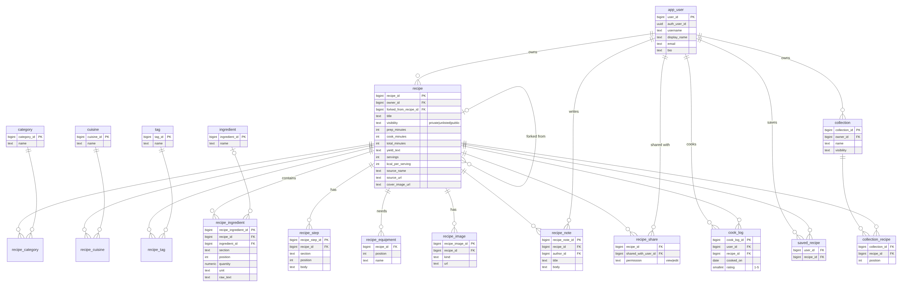

# Recipes DB: AI + SQL recipe sharing

A recipe sharing database seeded from my Obsidian recipe vault. People own recipes, choose who can see them (private, unlisted, or public), share them with specific friends, fork each other's recipes, log when they cooked something, and rate it. You can ask the database questions in plain English and an LLM turns them into SQL and back into a friendly answer.

This is my BYU CS 452 [AI + SQL project](https://github.com/byu-cs-452/byu-cs-452-class-content/tree/main/aisql), built to keep growing into a real personal recipe site.



## What's here

| Path | What it is |
| --- | --- |
| `db/schema.sql` | PostgreSQL tables (works on Supabase or any Postgres 15+) |
| `db/seed.sql` | Generated data: my 14 vault recipes plus 4 made-up users and their recipes, shares, cook logs, saves, and collections |
| `db/supabase.sql` | Supabase only: sign-up trigger, row-level security, and a read-only `recipe_bot` login |
| `importer/` | Parses the Obsidian notes in `vault/Recipes` (frontmatter + markdown) and writes `db/seed.sql` and `web/data/recipes.json` |
| `demo_recipes/` | The fake users' recipes, in the same Obsidian format |
| `bot/db_bot.py` | The natural language interface (question → SQL → rows → answer) |
| `web/` | Static site styled like an Obsidian Bases table and cards view |
| `docs/schema.mmd` | Source for the schema picture (Mermaid) |

## Data model

- **app_user**: a person. `auth_user_id` links to Supabase Auth once they sign up.
- **recipe**: owned by one user, with `visibility` of `private` (owner and people it's shared with), `unlisted` (anyone with the link), or `public` (listed for everyone). `forked_from_recipe_id` records "I adapted this from yours."
- **category**, **cuisine**, **tag**: lookup tables joined many-to-many to recipes. Categories match the vault (`meal`, `dessert`, `bread`, `snack or side`).
- **ingredient** and **recipe_ingredient**: each ingredient line keeps its original text plus a parsed quantity, unit, section (like "Icing"), and a canonical ingredient name, so "which recipes use butter" works across differently worded lines.
- **recipe_step**, **recipe_equipment**, **recipe_image**, **recipe_note**: ordered directions, tools, extra photos, and notes or comments.
- **recipe_share**: share one recipe with one user, as `view` or `edit`.
- **cook_log**: "I made it", with an optional date and 1–5 rating.
- **saved_recipe** and **collection** / **collection_recipe**: bookmarks and named lists like "Meal Prep".

## Run it

### 1. Database (Supabase, free)

1. Create a free project at [supabase.com](https://supabase.com).
2. In **SQL Editor**, run `db/schema.sql`, then `db/seed.sql`.
3. Edit the `CHANGE_ME` password near the bottom of `db/supabase.sql`, then run it.
4. To claim the seeded `celeste` user with your real login, run
   `UPDATE app_user SET email = 'you@example.com' WHERE username = 'celeste';`
   before you sign up. The sign-up trigger links them by email.
5. **Database > Schema Visualizer** shows the same diagram as `docs/schema.png`.

No Supabase yet? Any local Postgres works for the bot: `createdb recipes && psql recipes -f db/schema.sql -f db/seed.sql`.

### 2. Ask questions (OpenAI)

```bash
pip install -r requirements.txt
cp bot/config.example.json bot/config.json   # add your OpenAI key and database URL (never commit it)
python bot/db_bot.py                          # every question with every strategy
python bot/db_bot.py --ask "Which cookies has Maya made?"
```

On Supabase, use the **Connect > Session pooler** connection string, with user `recipe_bot.<project-ref>` and the password you set. The bot runs every query in a read-only transaction with a 5 second timeout, so a bad generated query can't change anything.

Each full run saves `bot/results/response_<strategy>_<time>.json` and an `examples_<time>.md` with every question, SQL, rows, and answer, ready to copy into the class post.

### 3. Website (GitHub Pages, free)

The site works with no setup: it reads `web/data/recipes.json`, which holds the public recipes only.

1. In the repo on GitHub: **Settings > Pages > Source: GitHub Actions**. The `pages.yml` workflow publishes `web/` on every push to `main`.
2. To read live data, put your Supabase **Project URL** and **anon public** key in `web/config.js`. The anon key is meant to be public; row-level security only lets it read public and unlisted recipes.

Preview locally with `python -m http.server -d web 8000`.

### Updating from the vault

Copy changed notes into `vault/Recipes/` (and covers into `web/images/`, lowercase with dashes), then run `python importer/build_seed.py` and reload `db/seed.sql`. CI fails if the generated files are out of date.

## Prompting strategies

From [Chang & Fosler-Lussier 2023](https://arxiv.org/abs/2305.11853):

| Strategy | Prompt contains |
| --- | --- |
| `zero_shot` | The `CREATE TABLE` statements (with comments) and the question |
| `zero_shot_with_rows` | Same, plus 3 example rows per table (the paper's "table content" finding) |
| `single_domain_few_shot` | Schema plus two worked question/SQL pairs from this database |
| `cross_domain_few_shot` | Two worked pairs from a different database (the class dog show), then this schema |

The friendly-answer prompt includes the question, the SQL, the column names, and the rows, and tells the model that "I" means celeste. This fixes the professor's example, where the model only saw bare ids.

## Results

_Fill these in from `bot/results/examples_<time>.md` after running the bot._

### A question it got right

**Question:**

```sql
```

**Answer:**

### A question it got wrong

**Question:**

```sql
```

**Answer:**

### What I noticed about the strategies

## Hosting and cost

| Piece | Choice | Cost |
| --- | --- | --- |
| Database + logins | Supabase free tier (500 MB Postgres, 50k monthly users) | $0. Free projects pause after 1 week idle; restore with one click. |
| Website | GitHub Pages | $0 |
| AI questions | OpenAI API, small model | A few cents for the whole assignment |

AWS would also work: S3 + CloudFront for the site is pennies a month, but a managed Postgres (RDS) is only free for the first 12 months and about $15/month after that, and you'd build sign-in yourself (Cognito). Supabase gives Postgres, auth, and row-level security together for free, which fits this project better.

## Ideas for later

- Sign in on the website (Supabase Auth magic links) and pages for "my recipes", "shared with me", and collections.
- An "Ask" box on the site that calls a Supabase Edge Function, so the OpenAI key stays on the server.
- Upload photos to Supabase Storage instead of `web/images`.
- Sync straight from the vault repo with a GitHub Action.
